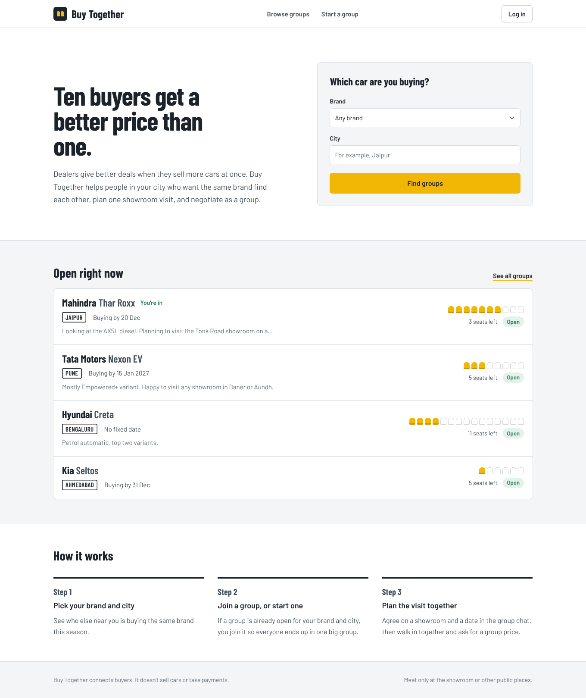
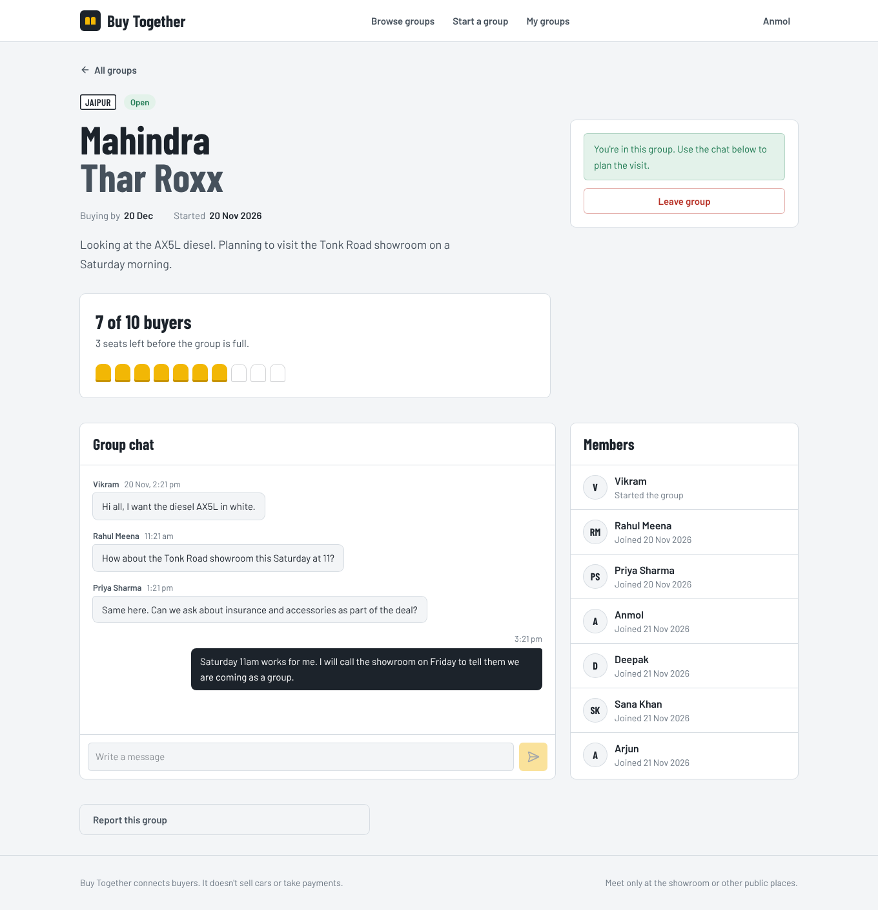
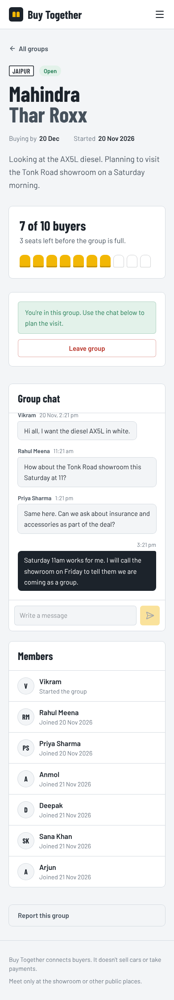

# Buy Together: frontend

The web app for **Buy Together**, where people in the same city who want the same car brand form a group, plan one showroom visit, and negotiate with the dealer together.

Backend: [Ak-Sat09/buy-together](https://github.com/Ak-Sat09/buy-together)



## What you can do

- **Log in with your mobile number.** Enter the 6-digit code, with a resend timer. Your first login creates the account and asks for your name.
- **Find groups** by brand and city right from the home page, or browse with filters for brand, city and status.
- **Start a group.** The app first checks whether people in your city are already buying that brand. If an open group exists, it shows that group so you can join it, because one big group gets a better price. If not, you fill in the model, group size, buying date and a note.
- **Group page:**
  - Seats fill up as people join.
  - Join or leave the group.
  - The creator can mark the deal as done or cancel the group, with a confirmation step for both.
- **Group chat and member list,** visible to members only. The chat refreshes every few seconds and becomes read only once a group finishes.
- **Report a group** that looks fake or abusive.
- **My groups** and **profile** pages.

| Group page | On mobile |
|---|---|
|  |  |

## Design

The look comes from the road itself:

- **Asphalt and lane-marking yellow.** Dark asphalt ink on a cool concrete-grey page. Yellow is kept for the one thing to act on: the main button, and the filled seats.
- **Seats instead of progress bars.** A group of 10 is drawn as 10 car seats, so "3 seats left" is something you see at a glance.
- **Cities on number plates.** Cities appear on a white plate with a black border, the way Indian buyers read places on the road.
- **Barlow and Barlow Condensed,** a typeface family in the spirit of highway signage. The condensed cut is used for headings.

It works on phones, has visible keyboard focus, labelled form fields, and respects reduced motion settings.

## Tech

| Area | Choice |
|---|---|
| Framework | React 19, TypeScript, Vite |
| Styling | Tailwind CSS 4 with design tokens in `src/index.css` |
| Routing | React Router 7 |
| Server data | TanStack Query (caching, polling for chat, paging) |
| Fonts | Barlow via Fontsource, bundled with the app |
| Icons | Lucide |

## Run locally

Start the [backend](https://github.com/Ak-Sat09/buy-together) first. By default it runs on port 8080 and already allows `http://localhost:5173`.

```bash
npm install
cp .env.example .env      # change VITE_API_URL if the backend is not on localhost:8080
npm run dev
```

Open http://localhost:5173. In development the OTP is printed in the backend log.

| Command | What it does |
|---|---|
| `npm run dev` | Dev server with hot reload |
| `npm run build` | Type check and production build into `dist/` |
| `npm run preview` | Serve the production build locally |
| `npm run typecheck` | TypeScript check only |

## Configuration

| Variable | Default | Purpose |
|---|---|---|
| `VITE_API_URL` | `http://localhost:8080` | Backend address. Set it at build time |

## Deploy on Vercel

1. Import this repository in Vercel. It detects Vite automatically.
2. Add `VITE_API_URL` with your backend URL, for example `https://api.example.com`.
3. Add the Vercel domain to the backend's `CORS_ALLOWED_ORIGINS` so the browser is allowed to call it.

`vercel.json` sends every path to `index.html`, so links like `/groups/123` work on refresh.

## Project structure

```
src
├── api/hooks.ts        All backend calls as TanStack Query hooks
├── auth/               Login session (stored in localStorage) and protected routes
├── components/         Shared pieces: buttons, form fields, seat strip, city plate, group list
├── features/group/     Group page parts: actions, chat, members, report form
├── lib/                API client with typed errors, shared types, date and phone formatting
└── pages/              One file per route
```

Errors from the backend arrive as `problem+json` with a stable `code`. The API client turns them into an `ApiError`, so pages can react to specific cases. For example, `OPEN_GROUP_EXISTS` while starting a group reloads the open groups to join.

Every push to `main` runs a type check and production build on GitHub Actions.
